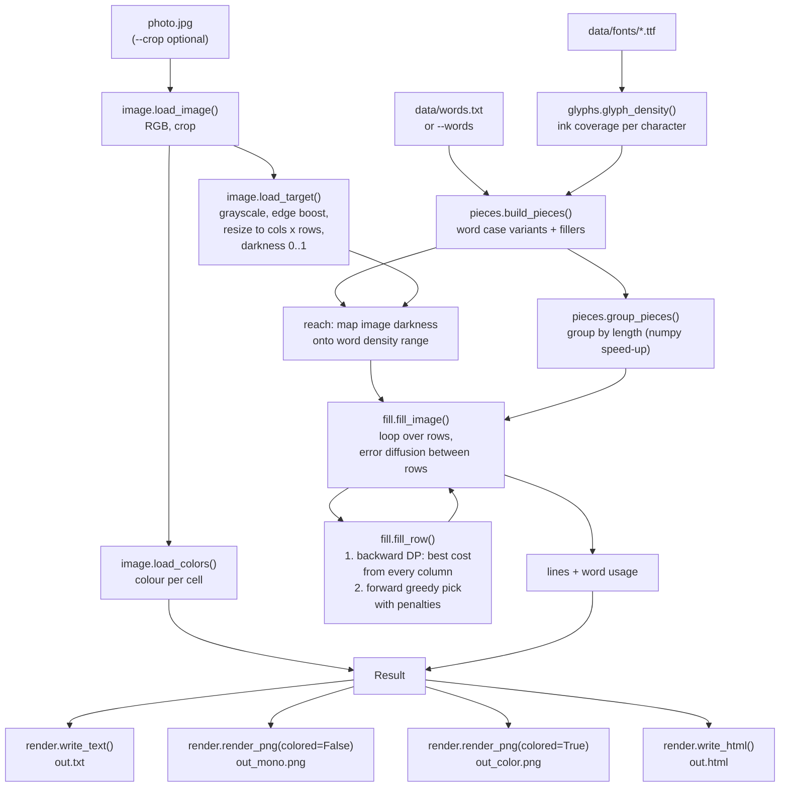

# cli-ascii-portrait

Turn a photo into ASCII art made of **words**. Each row of text is chosen so
that its ink density matches the darkness of the picture underneath, so dark
areas become UPPERCASE buzzwords and light areas become spaces and small
fillers.

## Requirements

- Python 3.14+
- Dependencies: `numpy` and `pillow` (installed by `uv sync`, or already in the project's `.venv`)

## Quick start

```bash
# from the project folder
mkdir -p results
.venv/bin/python -m cli_ascii_portrait path/to/photo.jpg -o results/me
```

With `uv` the same thing is:

```bash
uv run cli-ascii-portrait path/to/photo.jpg -o results/me
```

The run prints a summary and writes four files:

| File | Contents |
|---|---|
| `results/me.txt` | Plain text art, one line per row |
| `results/me_mono.png` | Black text on white |
| `results/me_color.png` | Text in the colours of the photo |
| `results/me.html` | Coloured art as a web page |

Open the results on macOS with `open results/me_color.png results/me.html`.

## Options

Run `python -m cli_ascii_portrait --help` for the full list. The most useful ones:

| Flag | What it does |
|---|---|
| `--cols N` | Width in characters (default 200). More columns means more detail and a slower run. |
| `--preset github` | 96 columns, GitHub code-block aspect, and only separators that text parsers split on (`--ats`). |
| `--invert` | Bright text for dark backgrounds. |
| `--crop L,T,R,B` | Crop the source image to a box in pixels before generating. |
| `--seed N` | Changes the random choices; the same seed gives the same output. |
| `--words FILE` | Use your own word list (whitespace separated; lines starting with `#` are comments). |
| `--font FILE` | Use a different `.ttf` font. |
| `--ats` | Only use filler characters that text parsers treat as word boundaries. |
| `-o PREFIX` | Output path prefix (default `out`). |

Tuning knobs such as `--repeat`, `--row-repeat`, `--word-bonus`, `--filler`,
`--jitter`, `--edge`, `--gamma`, `--lo`, `--hi` and `--diffuse` are all
documented in `--help`.

## Use it from Python

```python
from cli_ascii_portrait import Settings, generate

result = generate("path/to/photo.jpg", Settings(cols=120))
print("\n".join(result.lines))
```

`generate()` returns a `Result` with the text rows (`result.lines`), the colour
of each cell (`result.colors`), and which words were used (`result.vocab`,
`result.usage`).

## How it works

Each step lives in its own module under `src/cli_ascii_portrait/`.



In words:

1. **Load the picture** and turn it into a grid with one darkness value (0 =
   white, 1 = black) per character cell.
2. **Measure the font**: draw every character we might use and measure how much
   ink it covers.
3. **Build the vocabulary**: every word in four casings (as written, lower,
   Title, UPPER), plus single filler characters.
4. **Fill each row** from left to right. A backward dynamic programme first
   computes the cheapest way to finish the row from each column (a look-ahead).
   Then a forward pass picks the best piece at each position, with penalties
   for overused words, words repeated in the same row, and two words touching.
5. **Diffuse the error** into the next row so small mismatches don't build up
   into bands.
6. **Render** the rows as text, PNGs and HTML.

## Project layout

```
cli-ascii-portrait/
├── pyproject.toml
├── README.md
├── src/
│   └── cli_ascii_portrait/
│       ├── __init__.py      public API: generate(), Settings, main
│       ├── __main__.py      python -m cli_ascii_portrait
│       ├── cli.py           command-line flags, writes the output files
│       ├── settings.py      Settings dataclass and presets
│       ├── pipeline.py      generate(): runs every step in order
│       ├── core/
│       │   ├── image.py     picture -> darkness grid, colours
│       │   ├── glyphs.py    font loading, ink density per character
│       │   ├── pieces.py    word list -> placeable pieces, grouping
│       │   └── fill.py      row filling (DP + greedy), error diffusion
│       ├── render/
│       │   ├── text.py      .txt and markdown output
│       │   ├── png.py       mono and colour PNG
│       │   └── html.py      HTML output
│       └── data/
│           ├── words.txt    default word list
│           └── fonts/       DejaVuSansMono-Bold.ttf (see note below)
└── tests/
    ├── test_pieces.py
    ├── test_fill.py
    └── test_cli.py
```

## Font

The default font is expected at `src/cli_ascii_portrait/data/fonts/DejaVuSansMono-Bold.ttf`.
If the file is missing, the program falls back to Pillow's built-in font, so it
still runs, but the PNG output will look different. Copy the font file there,
or pass another one with `--font`.

## Development

Run the tests:

```bash
.venv/bin/python -m pytest -q
```

Lint:

```bash
.venv/bin/ruff check src tests
```
