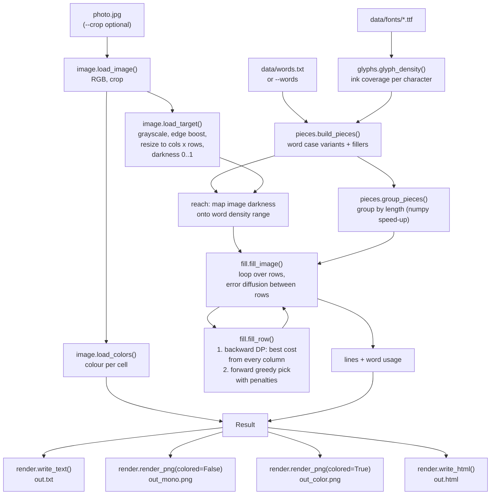

# cli-ascii-portrait

Turn a photo into ASCII art made of **words**. Each row of text is chosen so
that its ink density matches the darkness of the picture underneath, so dark
areas become UPPERCASE buzzwords and light areas become spaces and small
fillers.

## Example

This is the text output of `results/me.txt` (about 200 columns wide, so you may need to scroll):

```text
netlify#KUBERNETES#Serverless#Snowflake+Prometheus    refactor#Vue+vector+GCP#cursor    Airflow+envoy+Jest#Drizzle      ci     rollback#Python#TypeScript_svelte+Istio+rust_vitest/_infra;vite:         
CUDA=Lambda#SSO#microservices#Supabase#monorepo#etl         json#Vercel+stream#canary  react#API#yarn+latency/    redux  AI   nx_/Terraform##Azure#sprint+JavaScript/copilot  /Linux           ;;:::::; 
Next;claude#webhook#DevOps#cache#CYPRESS#async#nosql            rest#otel+cloud#saas+Tailwind#gRPC#PyTorch+Ansible trpc            ;css+queue#Agents+Prisma+await;  Pulumi__cqrs    ;___;;:: :          
sql turbo#DOCKER#node#neovim#LangChain#GITOPS#deploy             Postgres++embeddings#Deno#Prompt#Grafana++edge  _redis           /+backlog#k8s#Zod#Kafka=+agile :scrum#Spark/  ;______;;::;::::        
   llm#GRAPHQL#pnpm#Git/Playwright#OAuth+TypeScript             ;/vim=nginx+shard#mlops#Helm#CD#mongo##bun+Argo_ =bash+             =+###npm#microservices+_#dbt;   tdd#Serverless_refactor      :      
Istio#GPU#wasm#LangChain/Terraform#JavaScript#yaml;              vite; rollback#Prometheus#html#Kubernetes#await  react             vitest#mcp++=Playwright_netlify/+Snowflake;            :;;::        
claude#aws#Cypress#Jest latency#RAG#Copilot+Vercel                  Drizzle#embeddings#Supabase#DDD#PyTorch+jwt;                        ;+Cursor_/canary/  vector _TypeScript=svelte_infra:             
 /Python#webhook#CUDA#microservices#Postgres   _/                  rollback#monorepo#Ansible#CQRS#async+Kafka  __    linux                rust+Airflow=_stream#Drizzle#oauth#sprint:       ;:           
  lambda#Supabase#Docker _Tailwind#devops       /_                 neovim#Kubernetes#Prometheus#deploy#Envoy/   _   latency                 :  jwt  vector; rest   JavaScript+refactor_;:::  :          
   redux#cache#SPARK#microservices#Agents       ;/                Prisma#Grafana#LangChain#scrum#monorepo#next   /_Go#Sprint               :/   Istio+Serverless/+#cloud##Azure+otel  _;:               
   json#SHARD#backlog#netlify=Turbo#Pulumi       =                /claude#GRAPHQL#queue#Cypress#webhook#Vitest   _/JavaScript               /;   vercel/__redis Terraform#Docker/_;_====Yarn_;          
  trpc#POSTGRES#Snowflake#Airflow##refactor                      vue#Deno#TDD##edge##PyTorch#ARGO#Playwright++etl/+Serverless/              _/   :copilot+cursor_sso+embeddings=/__:;/microservices_;;: 
  infra#gRPC#SaaS#GitOps#Ansible+TypeScript  ci                terraform#Kubernetes=Snowflake#LangChain#Python+_ /latency  rust             _vitest#API /css#canary=+async#netlify_ _/_     jest_:vector
_nx   lambda#monorepo#microservices#nosql  ;rest  _/   vite   serverless#Prometheus#Svelte#bash#queue+Prompt#k8s rollback  next              /stream#PyTorch#Linux/+Azure/etl_    ;/react; sql;        ;
Git   :Pnpm#Grafana#agile;linux _refactor+Vercel; ;envoy#nosql tailwind#mongo#GCP#OAuth#Supabase#dbt#Drizzle#API_tRPC#AI_     :              cache##cursor==nginx+=redis_ Istio///_//_:;:   _;      rest
nx_ scrum#embeddings#yaml  _=Airflow#Kubernetes_ _canary#JavaScript#Agents#Prometheus#webhook#TURBO#RAG#Copilot  +Pulumi                     /svelte+Zod##TypeScript+await      ___vitest         otel  
netlify#Npm#DevOps#Prompt  :css/;cloud#LangChain  Prisma#mlops+Supabase#Postgres  +node#pnpm#MONGO#DDD#GRAPHQL/;     ci                      rollback+Playwright#microservices//__;    _;_:  latency    
Terraform#BACKLOG#vector  ;serverless#LangChain      redux#Kafka#SaaS#TypeScript  cloud#WASM#NODE#EMBEDDINGS#html                             :;vite+Tailwind#await=sprint    :_____jest    _json_      
_  ;/_  snowflake#Cypress  infra#Grafana#Copilot;_Airflow#neovim#Ansible#Python+  llm#MONOREPO#gRPC#DDD#BUN#Agents                            /refactor Istio+JavaScript_serverless:        rust        
linux#Prisma#deploy#canary:claude#Kubernetes#vercel  ;GitOps/redux#Cursor#devops  TERRAFORM#CQRS#MONGO#SHARD#MLOps=  /   _                    refactor;;/__stream#netlify                               
latency  lambda#Kubernetes  react#SPARK#agile    :;    _PyTorch#async#Drizzle+stream#WEBHOOK#DENO#DOCKER#GRAPHQL#Serverless                    =vitest: Istio+Envoy#microservices :_   ;;;   ;/:        
Docker   :rollback#microservices#TypeScript : trpc    svelte=cypress#Serverless+TDD#MONOREPO#MONGO#AWS#WEBHOOK#Nginx=  react                   /vercel_   turbo#Postgres     :     ; etl::::;/_         
Agents:  ;json#GRAPHQL      _JavaScript/;   Git:      ;_terraform#Kubernetes+SHARD#gpu#EMBEDDINGS#MONOREPO#PROMETHEUS ;nosql                      infra    snowflake+yarn=cursor  __;       __          
deploy/_ vim#ARGO#queue/;   _/javascript/    _   _     /__/TypeScript#backlog#WEBHOOK#GO#EDGE#WASM#RAG#pnpm#Supabase  :Pulumi                   _   _/_   :/sprint:/async_      : :/refactor/:          
microservices#CUDA#Copilot;  :/+Prometheus_  /Drizzle__vector  /    Prompt#TERRAFORM#MONGO#EMBEDDINGS#BUN#GRAFANA#Python+next                   ;_ _rust_;redis/   ;_+Azure____/Istio                   
KAFKA#neovim#GCP#microservices#Cypress#nginx   /netlify/       /    stream#DDD#MONOREPO#WEBHOOK#Npm#MONGO#PROMETHEUS#Ansible+                    __serverless/;  :;_claude;:_css;     ;:                
CUDA#Snowflake#LangChain+rollback#Postgres     vite/otel:         lambda#gRPC#WASM#EMBEDDINGS#MCP#EDGE#ARGO#SCRUM#Supabase#yarn                    _ci::/rest  :: :    react:    __;;;::;:              
REDUX#Helm#PLAYWRIGHT_ _Ansible#Snowflake/  vitest/netlify       :vue#CQRS#DOCKER#SHARD#Npm#NODE#BACKLOG#DENO#QUEUE#WEBHOOK#await             _next :_/cache;    :;Airflow__;  ;_;;;::                  
SPARK#SaaS#PYTORCH#agile=oauth#k8s#Kubernetes#Azure  /Prisma+Tailwind#MONOREPO#BUN#gpu#pnpm#RAG#CQRS#WASM#ZOD#gRPC#CD#WEBHOOK#dbt;           refactor=supabase;:::   __/vector;;;::::;;;:               
CACHE#Agents#bash#Redis/cloud#Supabase/_Playwright    _saas#CUDA#Lambda#DENO#EMBEDDINGS#MONOREPO#Npm#KUBERNETES#PROMPT#DOCKER#React         claude##Prometheus:   :__vitest:   :;___:                   
SSO#deploy#GRAFANA#Cypress+Python##Svelte+LangChain; _infra#SQL#CURSOR#NODE#MCP#MONGO#MONOREPO#DDD#AWS#GO#DENO#Edge#EMBEDDINGS#gpu;        +DEVOPS#backlog#sprint::;vite=Jest__;_vercel                 
POSTGRES#Kafka#GRAPHQL#OAuth#Terraform#Helm#SSO#Ansible#Envoy#TURBO#MONOREPO#SHARD#NOSQL#BACKLOG#KUBERNETES#SCRUM#ARGO#pnpm#PROMPT+       JAVASCRIPT=TypeScript      ;Pulumi  svelte                    
SPARK#bash#PYTORCH#Envoy#Copilot  Airflow#GRAFANA#Playwright#Lambda#WEBHOOK#PROMETHEUS#Serverless#async+Tailwind#EMBEDDINGS#GRAPHQL      latency/  JavaScript;__vitest_linux_; :__;                     
yaml#DEVOPS#Supabase#GitOps#Sprint_rollback#GCP#PyTorch#Python#SCRUM#DOCKER#KUBERNETES=Istio//jest_/infra/latency#Lambda#EMBEDDINGS:    canary#Airflow#Copilot_      ;vercel_refactor;::                
POSTGRES#GitOps#bash#LangChain  linux  cloud#Agents+Vue#Prisma#MONGO#NODE#GRAFANA#netlify   _AI  :__     :; ;_stream#SNOWFLAKE#yaml    rollback#ci=tRPC#html  :   :;__;:;/#Drizzle                      
queue#Neovim#KUBERNETES#Pulumi   rust/latency#microservices#TERRAFORM#MONOREPO#Cursor    vite  ;_;;;__netlify_ :;;_=YARN#WEBHOOK#dbt  vector#Kafka#Snowflake/;   ;:;_____=Svelte;::;::::                
LangChain#CACHE#GRAPHQL#TypeScript+JavaScript refactor    TURBO#NODE#PROMETHEUS#etl  __;       :              ;Istio/Lambda#WEBHOOK     rollback+Claude#React     :;_microservices_::                   
SPARK#BACKLOG#Zod#GRAFANA#Serverless#deploy     ;otel     TERRAFORM#MONOREPO#Git_  :;:             :                  _Lambda#NOSQL       :vitest#JavaScript     :::     sprint:   ::;:                 
mlops#Cypress#AZURE#DevOps#Drizzle#LangChain/:    etl     TERRAFORM#REDUX#Nginx___;                                    llm#DDD#await         /+TypeScript __       rest_rust  vector                    
TYPESCRIPT_claude#microservices/json#deploy  /    vite   TURBO#Npm#pnpm#Nginx_ ;;                                       :TDD#GRAPHQL        SSO#PROMPT+          :     ;vector       ::                 
Postgres/  _tRPC#Canary#Serverless#Kafka#agile/   jwt+stream#MONGO#ARGO#Netlify_:                                        ;YARN#NOSQL        =SPARK#Redux           :;_cursor/      :                    
microservices#PLAYWRIGHT#PyTorch+cache#JavaScript  vue /CYPRESS#MONGO#await_                                              vim#Redux         _embeddings/          ::;:  redis_;      :                  
/latency/   Tailwind#microservices+Supabase#API ci ;Airflow#PROMETHEUS#Drizzle                                             JSON#K8s         llm#SHARD#Git           ;;_      vercel                     
refactor_  _linux#Snowflake_  _rest+Playwright_    cloud#TERRAFORM#Agents_     :                                           supabase         _SaaS#Copilot         :;;;__;  :        :                   
svelte;:;  tailwind#Copilot   latency#CYPRESS#PyTorch#neovim#DDD#CQRS#Drizzle;;                                             TDD#OTel        rollback                :;;;;;;::                           
vitest__; :;:Airflow#canary_  infra#SERVERLESS#async#Envoy TERRAFORM#Next                                                  cuda#yaml       ==                      :;;;;:    :::::::          _refactor_
jest;:;_; ;_rollback#sprint    oauth#PLAYWRIGHT#json#queue=TURBO#WASM#otel;;;_;;                                            cd#GCP/       css                        ;;;;;;;:               linux=vector
vercel;       cache#Canary     /Kubernetes#bash#microservices#DENO#MLOps/ :;Istio:                            serverless_  ;Agents  /;    nx                      :;;;;;:     ::   :      ;/=+javascript
rest  ;;serverless#async_     tailwind#Prisma#BACKLOG//neovim#MONOREPO#Azure     Istio/netlify              stream#OAuth+scrum#GPU=refactor                          ::;;;;;;:   :       :_Ansible+infra
vitest_   _vercel+Pulumi    _Prometheus   json#GitOps   AI  TURBO#NODE#etl   _linux+TypeScript_;           refactor+vector supabase+_copilot                             ::    ::: ::   ;_/microservices
API  ;;   ;_Airflow+await    :latency    _rust+Prompt   _=: TURBO#gRPC#microservices#netlify             :;       :_  ; :_  Agents _refactor;   :_::jest         ;__     ::;;::       :_/serverless+vite
cursor;      vite+redis;      _react LangChain=envoy     Prisma#EDGE#await;  /vercel                    ;__   JavaScript    +bash;   _Yarn+sprint__:             rest     :;;;;;;;;;:;_serverless=Python
rust:      vitest#PyTorch:    JavaScript#Docker/redis    ;scrum#Npm#Agents/cursor   :LangChain_        :_Airflow#GRAPHQL/   tdd#Drizzle+canary                            ;svelte:  :_infra/Istio+=cache
next        ;;/TypeScript     JavaScript#Terraform_        +JSON#ARGO#dbt__; _; rollback#Docker/       _tailwind#Edge+SQL/  :Bun/  latency/;                                 infra_;_serverless+Supabase
/_          :css+TypeScript_rollback#queue#PyTorch          _Lambda#gRPC/netlify :PLAYWRIGHT=next; :   :;cursor+Kubernetes   k8s/  /Ansible                           AI        ci :__/latency#Snowflake
ci           _claude#Drizzle+Zod#Prometheus=vitest            KUBERNETES/       vim#LangChain+sprint    ;;copilot/otel       tRPC=svelte_                       :;    css      rest _Azure+Python#DEVOPS
             ::LangChain saas#POSTGRES#TypeScript=            Lambda#agile/_;   _vector_/vercel        ;_;linux_      :      :SQL=cypress                        /;    _nx      /+  tailwind#DEVOPS#CQRS
             Airflow#Jest/snowflake#DEVOPS#mcp#nosql           SPARK#Nginx__;;etl          :  _/__    :__    ;_cursor         envoy+sso                         ;jwt            //   stream#queue#DOCKER
            Ansible#deploy#Grafana#Prometheus#Copilot          Zod#PROMPT __;             :Istio: ;;;_;;_;   ;;      __:       jwt                               react  refactor     lambda#SHARD#DEVOPS
          terraform#Kubernetes#microservices+latency_   Azure/neovim#Next/vite_;     ;_          ;____;;__    ;__:  ;;:;       API                               ;react_;=Pulumi     rag#ARGO#PROMETHEUS
           rollback#microservices+cd+canary/TypeScript  refactor:: ;copilot;         ;;          Istio   :    _/;              jwt                               _=sprint+vector    cloud#Helm#CUDA#gRPC
            redux#microservices_ /netlify ;+JavaScript :=Serverless_redis :__:      ;_:         :           :otel;             Jest                              linux#Prometheus  :Snowflake#embeddings
             claude#dbt_   react  vitest    /html   /    ;canary _serverless_       :;:        Istio:          ;AI             Git                                 cloud#GitOps#Prisma#Supabase#POSTGRES
            __ ;LangChain/:  css rust        nosql         cd  sql  /netlify;:                                 rest            nx                                   /neovim#Kafka#Python#Postgres#DOCKER
            /Airflow#Serverless   _API        aws_             ;   refactor;;:                 _  rust     /sprint             AI                                   claude#Supabase#Snowflake#Python#BUN
              rest+TypeScript/     trpc       =_               _/   __svelte_:                 vercel__linux#Azure:            =_                                    :Playwright#CYPRESS#Kubernetes#Pnpm
               cuda#async/Jest     vite       next              microservices;                   cursor;;:vector               ;                                       latency#deploy#Envoy#SaaS#Grafana
                cache#Ansible_                redis_             __vercel_:  :;                :_; :   :_   ;: ;etl;                                                    _vue#backlog#Snowflake#Helm#node
                 redux#async/_                   ;               microservices_;             :;vitest :serverless___;                                                :;;Prisma#deploy#embeddings#Ansible
                claude#Drizzle                                   /_   vitest  :;           ;svelte       :         :_:         _                                           stream#queue#POSTGRES#PyTorch
              ;rollback#agile;                                   _Drizzle: rust;          ::          _javascript;            ;=                            linux   :;;     snowflake#GRAPHQL#Kubernetes
               tailwind#Copilot                                    _   Yarn;   ::       ;;_;;;__netlify__vitest:react:                   sso                :rest;:   :;;:::claude#embeddings#Playwright
                  cloud#await_                                     ;/_  refactor:      _infra+microservices+=cypress_;                    vue;          ;//vitest;  :;;:     rag#webhook#backlog#PYTORCH
                    refactor/:                                          ;_  :             cache#Drizzle#svelte//sprint:                    _otel        jest+vector: :;;;: stream#KUBERNETES#Kafka#await
                    _cursor                                              Azure/;:       ;/_ microservices_svelte                           _cqrs;       javascript__;;;;     cloud#mlops#Kubernetes_    
                    _redis                                               netlify;                        ci                                refactor     terraform#Git_;;;;  vim#Supabase#LangChain      
                     cursor                                               vercel;;                    :__  ___: :                          redux+css     _yaml_  saas__;:    zod#OAuth#Prometheus_      
                       jwt                                                netlify_;  :;                  _;   infra     ;_;                 TypeScript     trpc  canary;;Airflow#embeddings#Cypress;    
                  ;ci                                                     Istio/jest; :;                   ::           :                   rollback_:;           agile:     Prometheus#bash#Docker:    
                 cqrs                                                     etl_rust;;_____;: ::                         :_/:                   /TypeScript        _Agents__Airflow#embeddings#Redux_     
                  __                                                      rest: ;vector;;__   :              :        linux                    LangChain ;        nosql       SHARD#POSTGRES#Envoy;   __
                                                                           _ _Drizzle;:Istio:               :_;      ;react_                   _edge#Sprint:       vue_       ;supabase#LangChain  scrum
                                                                           etl     vite_    ;_:            ;_____   ;/latency                  lambda#Azure_       :;       ;_  llm#Supabase#yaml_  cuda
                                                                           /: :;    _javascript;    ;_; :::_cursor/stream#Deno                  Lambda#await_          _vitest   llm#BACKLOG#mlops/SPARK
                                                                           otel        _vector_microservices;vite/Prisma#Pulumi;                _Pnpm#Nginx/_;         Yarn:;_;:   cuda#POSTGRES#Grafana
                                                                           =;        :__  serverless;_//javascript:  cloud#Pulumi                 JSON#Copilot:      _/_vercel_;_   TURBO#GRAFANA#GitOps
                                                                          ;API;        ;_;   ;_svelte+Serverless_   tRPC#Supabase                  :rollback;  :      css     ;;;   _POSTGRES#Kubernetes
                  __                                                   Istio  ;           :;;:    _latency=sprint:  oauth#GRAPHQL_                   _serverless       _svelte____  ;TURBO#deploy#Neovim
                    _:                                                  react_:                           ;        _SPARK#GCP#html                    :               ;serverless   lambda#ARGO#Agents_ 
                                                                       await::                                     =CYPRESS#DevOps                     ;   nx  ci      ;;;  ;;      /Python#GPU#Redux   
                 __                                                   =await__                                    :Snowflake#async                        rest  /    typescript_   scrum#oauth+saas/    
                  _:                                                 Lambda=_;;                                   :POSTGRES#Docker                       _netlify:  _refactor;;_   TypeScript           
                   ;                                               TURBO#await                                    stream#webhook/                        async_      serverless   /PyTorch              
                                                              stream#SHARD#dbt                                    :LangChain#Nginx                       =vercel       infra       rust                 
                                                          vim#MONOREPO#BUN#gRPC_                                  rag#k8s#Canary                        /copilot      :vitest      redis             ___
                                                       _TERRAFORM#WEBHOOK#GRAPHQL                                  PROMETHEUS#otel                _/_;  =Playwright     /Yarn       vue            _vite
                                                     JSON#MONOREPO#MONGO#GO#GRAPHQL                                TDD#NODE#Supabase_              sso trpc+Ansible :  ;vector:     ;netlify      __;   
                                                   TERRAFORM#MONOREPO#WEBHOOK#GRAPHQL                              :SHARD#EMBEDDINGS#API_   __   :otel rest+JavaScript  _vector      vercel      Istio_:
                                                 _Pnpm#MONOREPO#Npm#MONGO#AWS#SHARD#SQL                            ;#DENO#WASM#GRAFANA#Copilot  react  rollback#next   :linux:       canary_    :  ;    
                                                TERRAFORM#DENO#WEBHOOK#DDD#EMBEDDINGS#dbt                          TURBO#MONOREPO#DOCKER#Agents/redis  ;/Python#Sprint_ :_infra_    latency ;/javascript
                                              tdd#MONGO#DENO#MONOREPO#Npm#WASM#WEBHOOK#Nginx                       _SCRUM#KUBERNETES#PROMETHEUS#queue//Tailwind#microservices;      typescript=/cursor_/
                                           cloud#WEBHOOK#MONOREPO#WASM#EMBEDDINGS#pnpm#PROMPT+:                   ;Lambda#GO#BACKLOG#GRAFANA#ARGO#queue#Tailwind#agile    css_     :microservices_cursor
                                      claude#WEBHOOK#MONGO#DDD#EMBEDDINGS#BUN#DENO#MONOREPO#OAuth;                rag#pnpm#DOCKER#Edge#KUBERNETES#BACKLOG#Envoy#Canary   Istio   ;;:_svelte=vercel/_vite
                                    TERRAFORM#DDD#NODE#WASM#DENO#AWS#WEBHOOK#Npm#gRPC#PROMETHEUS#API_             /POSTGRES#SNOWFLAKE#DOCKER#KUBERNETES#CYPRESS#deploy    netlify=microservices/refactor
                                 _Lambda#MONOREPO#MONGO#WASM#NODE#Npm#CQRS#GRAPHQL#DEVOPS#AWS#BASH#Agents:      :/SPARK#SNOWFLAKE#PROMETHEUS#REDUX#MLOps#GO#Edge#await_   rust_;refactor/=microservices/
                              _TERRAFORM#CQRS#MONGO#WEBHOOK#NODE#MONOREPO#BUN#WASM#Edge#GRAFANA#MCP#CUDA#PyTorch#CACHE#AWS#NOSQL#GRAPHQL#PROMPT#EMBEDDINGS#gRPC#Copilot   serverless=refactor=javascript
                           _TERRAFORM#GO#MONOREPO#gpu#WEBHOOK#MONGO#Npm#BUN#gRPC#Edge#DDD#BACKLOG#KUBERNETES#POSTGRES#RAG#MLOps#K8S#DEVOPS#CYPRESS#GRAFANA#PROMPT#yaml   linux /serverless==vector/infra
                         PYTHON#EMBEDDINGS#NODE#PROMETHEUS#DOCKER#QUEUE#WASM#Edge#REDUX#HELM#KUBERNETES#GRAPHQL#BACKLOG#MCP#SHARD#CQRS#YARN#DDD#GRAFANA#RAG#SCRUM#async :Jest_serverless=Ansible=netlify
                       JSON#PROMETHEUS#MONGO#EMBEDDINGS#gRPC#WEBHOOK#NODE#SCRUM#DOCKER#ARGO#NOSQL#PROMPT#CUDA#KAFKA#DENO#pnpm#GRAPHQL#POSTGRES#KUBERNETES#SPARK#SaaS#microservices=javascript=next/infra
                      TERRAFORM#EMBEDDINGS#Npm#MONOREPO#PROMPT#DENO#DDD#PROMETHEUS#SHARD#CQRS#BACKLOG#SNOWFLAKE#GCP#gpu#QUEUE#NODE#AZURE#GRAFANA#K8S#POSTGRES#MONGO#deploy/latency+microservices=netlify
                     TDD#MONOREPO#EMBEDDINGS#WEBHOOK#MONGO#ARGO#pnpm#KUBERNETES#MCP#GCP#DOCKER#PROMETHEUS#Edge#SNOWFLAKE#QUEUE#KAFKA#REDUX#POSTGRES#BASH#NOSQL#HELM#Agents+microservices=refactor/jest  
                    TERRAFORM#ARGO#CQRS#MONOREPO#SNOWFLAKE#BUN#MONGO#WASM#CURSOR#Npm#QUEUE#DOCKER#JSON#PROMETHEUS#Supabase#REDUX#KUBERNETES#ZOD#EMBEDDINGS#gRPC#WEBHOOK#Ansible=typescript+PyTorch_     
                    KUBERNETES#MONGO#MONOREPO#EMBEDDINGS#DEVOPS#GO#SHARD#PROMPT#BACKLOG#gRPC#OAUTH#BASH#KAFKA#SSO#CQRS#ARGO#gpu#GCP#CLAUDE#CACHE#CUDA#WASM#SCRUM#DENO#DBT#microservices+javascript_     
                   TERRAFORM#BASH#BUN#SCRUM#EMBEDDINGS#Npm#PROMPT#DDD#PROMETHEUS#BACKLOG#RAG#KUBERNETES#SUPABASE#GRAFANA#CQRS#REDUX#SaaS#CUDA#pnpm#ENVOY#TURBO#WEBHOOK#DENO#microservices=vercel        
                   SCRUM#MCP#MONOREPO#Npm#EMBEDDINGS#DOCKER#AZURE#MONGO#PROMETHEUS#GRAPHQL#BACKLOG#KUBERNETES#K8S#REDUX#CURSOR#CYPRESS#SaaS#TERRAFORM#MLOps#ZOD#SHARD#NODE#microservices/etl_;          
                  TURBO#WEBHOOK#pnpm#KUBERNETES#DDD#DOCKER#GRAFANA#CURSOR#PROMETHEUS#DEVOPS#SPARK#SNOWFLAKE#BACKLOG#BASH#QUEUE#Npm#MLOps#AZURE#CACHE#Edge#DENO#SHARD#MONOREPO#Ansible                   
                  TERRAFORM#pnpm#PROMETHEUS#MONOREPO#CD#EMBEDDINGS#MONGO#MCP#SNOWFLAKE#SUPABASE#NOSQL#GRAPHQL#PLAYWRIGHT#CANARY#SSO#KAFKA#ROLLBACK#ZOD#SHARD#TURBO#gRPC#WASM#Drizzle                    
                 LLM#TERRAFORM#MONOREPO#WEBHOOK#ARGO#MLOps#WASM#DOCKER#CD#PROMETHEUS#POSTGRES#OAUTH#ENVOY#PYTHON#SPARK#Edge#LANGCHAIN#KAFKA#ROLLBACK#SHARD#DENO#NODE#BASH#deploy+Istio               etl
                 tRPC#KUBERNETES#WEBHOOK#CQRS#MONGO#DENO#PROMETHEUS#MONOREPO#DEVOPS#CLAUDE#POSTGRES#PLAYWRIGHT#STREAM##pnpm#Helm###GRAPHQL#PYTORCH#CURSOR#AWS#SCRUM#Npm#PROMPT#Ansible_           _Istio
                 Lambda#CUDA#MONOREPO#SCRUM#GRAFANA#KUBERNETES#TERRAFORM#DEVOPS#Supabase#LANGCHAIN#PROMPT#PYTHON#RAG#CQRS#SHARD#AWS#EMBEDDINGS#CLOUD#CURSOR#SNOWFLAKE#REDUX#Drizzle_           ;=Airflow
                 TERRAFORM#WEBHOOK#SNOWFLAKE#ARGO#MONOREPO#RAG#MLOps#SPARK#PROMETHEUS#AZURE#CYPRESS#PLAYWRIGHT#Lambda#Supabase#PYTORCH#YARN#SaaS#BACKLOG#CLAUDE#NODE#MONGO#Redis              stream#VUE
                lambda#BACKLOG#WEBHOOK#MONOREPO#gRPC#PROMETHEUS#MONGO#WASM#GO#AGENTS#SSO#CLOUD#PYTORCH#pnpm#PYTHON#YARN#TURBO#PROMPT#SNOWFLAKE#GRAFANA#POSTGRES#SCRUM#BUN#MLOps              _tdd#CANARY
                lambda#KUBERNETES#SNOWFLAKE#PROMETHEUS#MONOREPO#TERRAFORM#POSTGRES#SUPABASE#CYPRESS#CANARY#Helm#AGENTS#NEOVIM#GRAFANA#GRAPHQL#DEPLOY#CURSOR#AWS#DOCKER#DDD#Netlify/_:       llm#SaaS#K8S
                JSON#WEBHOOK#EMBEDDINGS#SUPABASE#MONOREPO#MCP#Edge#ARGO#MONGO#GRAPHQL#PYTORCH#CYPRESS#PLAYWRIGHT#AZURE#OAUTH#POSTGRES#DEVOPS#REFACTOR#NEOVIM#HTML#GCP#PRISMA#Ansible=     _stream#CANARY
                tRPC#QUEUE#EMBEDDINGS#gpu#SCRUM#MCP#DOCKER#CURSOR#WEBHOOK#CACHE#GRAFANA#GITOPS#ROLLBACK#Kafka#SPARK#K8S#RAG#KUBERNETES#Edge#OAUTH#REACT#CUDA#CD#NODE#DDD#BUN#Copilot     cloud#SHARD#SSO
                Lambda#MONOREPO#WEBHOOK#PROMETHEUS#NODE#KUBERNETES#BACKLOG#EMBEDDINGS#Supabase#GITOPS#SPARK#OAUTH#ENVOY#ROLLBACK#ZOD#gpu#ARGO#NOSQL#CUDA#SSO#TERRAFORM#Edge#React      stream#SERVERLESS
                LANGCHAIN#EMBEDDINGS#DOCKER#GRAFANA#SCRUM#MONOREPO#MONGO#GCP#KUBERNETES#CLAUDE#POSTGRES#SERVERLESS#CANARY#BASH#TDD#DBT#AGENTS#REFACTOR#GRAPHQL#TERRAFORM#gpu#OTel     Prisma#CURSOR#Helm
                 KUBERNETES#EMBEDDINGS#WEBHOOK#gRPC#DENO#DDD#pnpm#TERRAFORM#SERVERLESS#deploy#CYPRESS#ASYNC#LangChain#ZOD#SHARD#CUDA#SNOWFLAKE#DEVOPS#ROLLBACK#CD#YARN#gpu#SQL#API  tailwind#QUEUE#Envoy
                 TURBO#MONOREPO#CQRS#BUN#POSTGRES#gRPC#REDUX#MCP#SCRUM#WEBHOOK#NGINX#PYTHON#KAFKA#AZURE#CLAUDE#PYTORCH#CURSOR#BACKLOG#SPARK#ENVOY#CACHE#QUEUE#STREAM#NOSQL#TypeScript/Lambda#deploy#yaml
                 TDD#DEVOPS#QUEUE#MONOREPO#WEBHOOK#SNOWFLAKE#REDUX#PROMETHEUS#BASH#Supabase#CYPRESS#PYTORCH#LangChain#CACHE#TURBO#KUBERNETES#NX#NGINX#BACKLOG#SPARK#YARN#MLOps#netlify#TYPESCRIPT#neovim
                 AGENTS#TURBO#PROMETHEUS#Npm#KUBERNETES#WASM#MONOREPO#CURSOR#BUN#ROLLBACK#Supabase#ASYNC#SPARK#PLAYWRIGHT#Lambda#SERVERLESS#MLOps#gRPC#CYPRESS#JSON#RAG#DEVOPS#Pulumi+latency#JavaScript
                 TERRAFORM#EMBEDDINGS#NOSQL#GRAFANA#DOCKER#POSTGRES#PROMPT#DDD#Supabase#CACHE#GITOPS#deploy#LangChain#Lambda#CURSOR#BACKLOG#GRAPHQL#SQL#Kafka#DEVOPS#REDUX#NGINX#JavaScript#TypeScript/_
                 JSON#DOCKER#PROMPT#NOSQL#GRAFANA#SNOWFLAKE#STREAM#GO#QUEUE#GRAPHQL#DEVOPS#PLAYWRIGHT#Supabase#GITOPS#ASYNC#ROLLBACK#AZURE#Helm#REDUX#K8S#deploy#CUDA#EMBEDDINGS#Copilot#TypeScript=vite
```

The same run also writes a black-on-white version ([`me_mono.png`](results/me_mono.png)) and a web page ([`me.html`](results/me.html)).

## Requirements

- Python 3.14+
- Dependencies: `numpy` and `pillow` (installed by `uv sync`, or already in the project's `.venv`)

## Quick start

```bash
# from the project folder
mkdir -p results
.venv/bin/python -m cli_ascii_portrait path/to/photo.jpg -o results/me
```

With `uv` the same thing is:

```bash
uv run cli-ascii-portrait path/to/photo.jpg -o results/me
```

The run prints a summary and writes four files:

| File | Contents |
|---|---|
| `results/me.txt` | Plain text art, one line per row |
| `results/me_mono.png` | Black text on white |
| `results/me_color.png` | Text in the colours of the photo |
| `results/me.html` | Coloured art as a web page |

Open the results on macOS with `open results/me_color.png results/me.html`.

## Options

Run `python -m cli_ascii_portrait --help` for the full list. The most useful ones:

| Flag | What it does |
|---|---|
| `--cols N` | Width in characters (default 200). More columns means more detail and a slower run. |
| `--preset github` | 96 columns, GitHub code-block aspect, and only separators that text parsers split on (`--ats`). |
| `--invert` | Bright text for dark backgrounds. |
| `--crop L,T,R,B` | Crop the source image to a box in pixels before generating. |
| `--seed N` | Changes the random choices; the same seed gives the same output. |
| `--words FILE` | Use your own word list (whitespace separated; lines starting with `#` are comments). |
| `--font FILE` | Use a different `.ttf` font. |
| `--ats` | Only use filler characters that text parsers treat as word boundaries. |
| `-o PREFIX` | Output path prefix (default `out`). |

Tuning knobs such as `--repeat`, `--row-repeat`, `--word-bonus`, `--filler`,
`--jitter`, `--edge`, `--gamma`, `--lo`, `--hi` and `--diffuse` are all
documented in `--help`.

## Use it from Python

```python
from cli_ascii_portrait import Settings, generate

result = generate("path/to/photo.jpg", Settings(cols=120))
print("\n".join(result.lines))
```

`generate()` returns a `Result` with the text rows (`result.lines`), the colour
of each cell (`result.colors`), and which words were used (`result.vocab`,
`result.usage`).

## How it works

Each step lives in its own module under `src/cli_ascii_portrait/`.



In words:

1. **Load the picture** and turn it into a grid with one darkness value (0 =
   white, 1 = black) per character cell.
2. **Measure the font**: draw every character we might use and measure how much
   ink it covers.
3. **Build the vocabulary**: every word in four casings (as written, lower,
   Title, UPPER), plus single filler characters.
4. **Fill each row** from left to right. A backward dynamic programme first
   computes the cheapest way to finish the row from each column (a look-ahead).
   Then a forward pass picks the best piece at each position, with penalties
   for overused words, words repeated in the same row, and two words touching.
5. **Diffuse the error** into the next row so small mismatches don't build up
   into bands.
6. **Render** the rows as text, PNGs and HTML.

## Project layout

```
cli-ascii-portrait/
├── pyproject.toml
├── README.md
├── src/
│   └── cli_ascii_portrait/
│       ├── __init__.py      public API: generate(), Settings, main
│       ├── __main__.py      python -m cli_ascii_portrait
│       ├── cli.py           command-line flags, writes the output files
│       ├── settings.py      Settings dataclass and presets
│       ├── pipeline.py      generate(): runs every step in order
│       ├── core/
│       │   ├── image.py     picture -> darkness grid, colours
│       │   ├── glyphs.py    font loading, ink density per character
│       │   ├── pieces.py    word list -> placeable pieces, grouping
│       │   └── fill.py      row filling (DP + greedy), error diffusion
│       ├── render/
│       │   ├── text.py      .txt and markdown output
│       │   ├── png.py       mono and colour PNG
│       │   └── html.py      HTML output
│       └── data/
│           ├── words.txt    default word list
│           └── fonts/       DejaVuSansMono-Bold.ttf (see note below)
└── tests/
    ├── test_pieces.py
    ├── test_fill.py
    └── test_cli.py
```

## Font

The default font is expected at `src/cli_ascii_portrait/data/fonts/DejaVuSansMono-Bold.ttf`.
If the file is missing, the program falls back to Pillow's built-in font, so it
still runs, but the PNG output will look different. Copy the font file there,
or pass another one with `--font`.

## Development

Run the tests:

```bash
.venv/bin/python -m pytest -q
```

Lint:

```bash
.venv/bin/ruff check src tests
```
